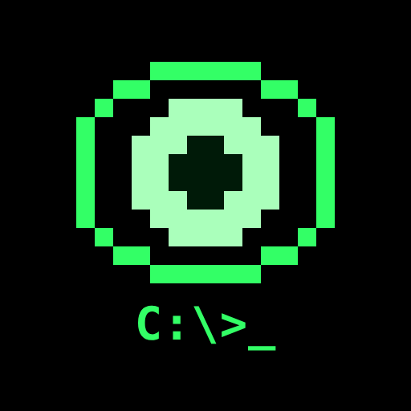
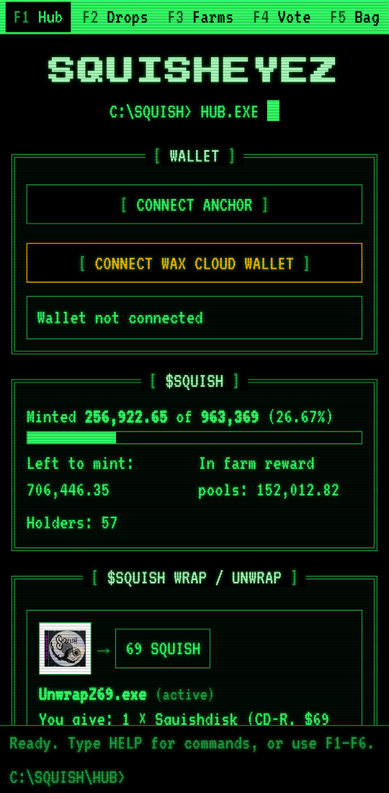
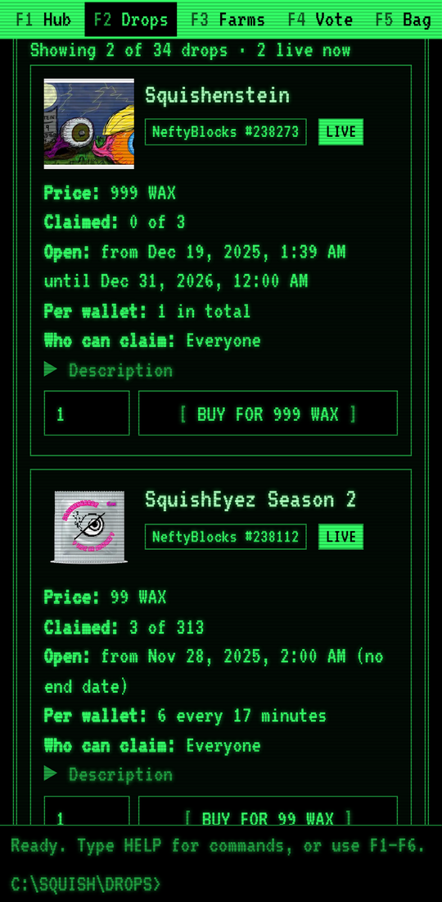
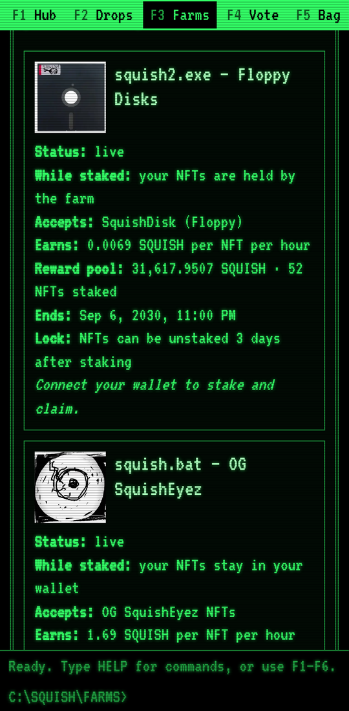
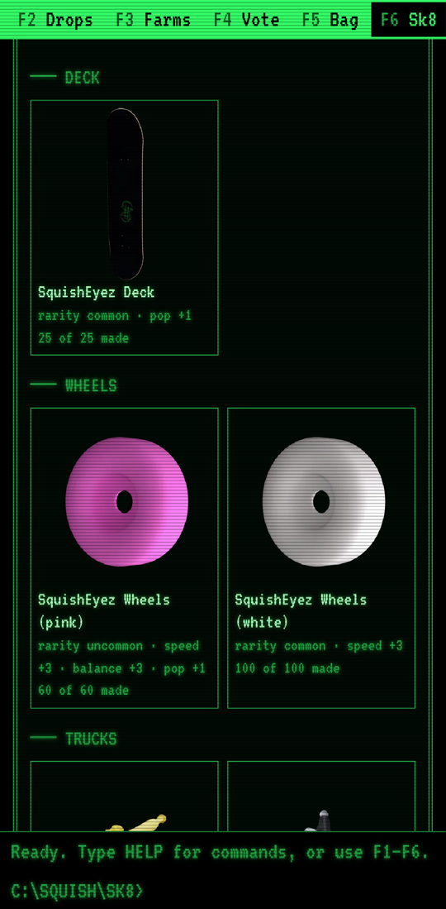

<p align="center">
  
</p>

<h1 align="center">SquishHub</h1>

<p align="center">
  <b>The all-in-one hub for the SquishEyez NFT collection and $SQUISH on WAX.</b><br>
  Android and Linux · open source · no accounts, no tracking
</p>

<p align="center">
  <a href="../../releases/latest"><b>⬇ Download the latest release</b></a> ·
  <a href="#install"><b>How to install</b></a> ·
  <a href="SECURITY.md"><b>Security</b></a>
</p>

<p align="center">
  
  
  
  
</p>

```
C:\SQUISH> HUB.EXE
```

SquishHub puts everything you can do with
[SquishEyez](https://wax.atomichub.io/explorer/collection/wax-mainnet/ssquisheyezz)
(`ssquisheyezz` on WAX) and its token **$SQUISH** in one app, with a DOS look.
It talks straight to the WAX smart contracts, so drops, farms, blends and
voting keep working even when the NeftyBlocks, NFTHive or WaxDAO websites
don't.

Everything you do is with **your own** NFTs and tokens. You approve each
action in your own wallet, and the WAX contracts check it against the account
that signed it. SquishHub never sees your keys.

## What you can do

| Key | Page | |
|---|---|---|
| **F1** | **Hub** | Wrap 69 $SQUISH into a CD-R NFT and back · fuse Season 2 Shardz (Top + Bottom + Blend Diskette → Squisheye²) · open packs |
| **F2** | **Drops** | Every SquishEyez drop on NeftyBlocks and NFTHive: buy or claim live drops, and withdraw unspent deposits |
| **F3** | **Farms** | Stake and unstake your SquishEyez, and claim your $SQUISH rewards |
| **F4** | **Vote** | SquishDAO community voting: one vote per OG or Season 2 SquishEyez you hold. Nothing is staked or locked |
| **F5** | **Bag** | Your $SQUISH, WAX and SquishEyez NFTs, tagged with what each one can be used for |
| **F6** | **Sk8** | The SquishEyez × [Sk8Coin](https://www.sk8coin.io/) collab: your SKATE balance, every board part (deck, wheels, trucks, bearings) with its live drops, and building a complete SquishEyez skateboard |

Every page also shows the **$SQUISH window**: how much has been minted against
the fixed cap of **963,369**, what's left to mint, what sits in farm reward
pools, and how many people hold it.

## Install

| Platform | File | How |
|---|---|---|
| **Android** 7.0+ | `squishhub-<version>.apk` | Open it on your phone and allow the install if Android asks |
| **Ubuntu / Debian / Mint** | `squishhub-<version>-amd64.deb` | `sudo apt install ./squishhub-<version>-amd64.deb` |
| **Any Linux** | `squishhub-<version>-x86_64.AppImage` | `chmod +x squishhub-*.AppImage && ./squishhub-*.AppImage` |

Download the files from the [Releases page](../../releases/latest) and check
them against `SHA256SUMS.txt`:

```bash
sha256sum -c SHA256SUMS.txt --ignore-missing
```

On Ubuntu 24.04 and newer the AppImage may close straight away, because Ubuntu
restricts the sandbox that Chromium-based apps use. Install the `.deb`
instead: it sets the sandbox up properly.

Only download SquishHub from this repository. [SECURITY.md](SECURITY.md)
explains how to check that an APK is genuine.

## Connect your wallet

- **Anchor:** on Android, SquishHub opens the Anchor app for you to approve
  and then returns. On Linux, use the
  [Anchor desktop app](https://anchorwallet.io/download), or scan the QR code
  with Anchor on your phone.
- **WAX Cloud Wallet:** sign in and approve in the pop-up window.

Nobody from SquishEyez will ever ask for your seed phrase, private key or
wallet password, and SquishHub never will either.

## The command prompt

The bottom line is a working DOS prompt. Type `HELP` to see everything:

```
HUB  DROPS  FARMS  VOTE  BAG  SK8      switch pages (or F1–F6, or CD FARMS)
CONNECT  CLOUD  LOGOUT  WHOAMI         wallet
THEME GREEN|AMBER|BLUE|GREY            colour scheme
VER  CLS                               version, clear
```

## Build from source

Requirements: Node.js 20+. For Android also JDK 21 and the Android SDK
(platform 36). See [ANDROID.md](ANDROID.md).

```bash
npm install
npm run dev             # run it in your browser: http://localhost:5173
npm run build           # website -> dist/
npm run android:build   # Android APK, debug
npm run android:release # Android APK, signed with the release key
npm run desktop:build   # Linux AppImage + .deb -> desktop/release/
```

The same code also runs as a website: `netlify.toml` builds it with
`npm run build` and publishes `dist/`.

Every transaction SquishHub builds was checked with `compute_transaction` on
WAX mainnet: the chain runs it exactly as if it were signed, without signing
or saving it.

<details>
<summary><b>Code map</b></summary>

| File | |
|---|---|
| `src/config.js` | Collection, token, contracts, farms, blends, packs, DAO |
| `src/chain.js` | WAX and AtomicAssets reads with failover, formatting helpers |
| `src/wallet.js`, `src/permissions.js` | WharfKit sign-in (Anchor, WAX Cloud Wallet) and signing |
| `src/blends.js`, `src/neftyblends.js`, `src/packs.js` | Wrap/unwrap, Shardz fusion, packs |
| `src/drops.js`, `src/dropsPage.js` | Drops on NeftyBlocks and NFTHive |
| `src/farms.js`, `src/farmsPage.js` | Farms |
| `src/dao.js`, `src/votePage.js` | SquishDAO voting |
| `src/token.js` | $SQUISH supply |
| `src/inventoryPage.js` | Bag |
| `src/sk8Page.js` | SquishEyez × Sk8Coin collab |
| `src/dos.js`, `src/ui.js`, `index.html` | DOS shell, UI helpers, layout and themes |
| `android/` | Android app (Capacitor) |
| `desktop/` | Linux app (Electron): a locked-down window around the same web app |

</details>

## Security

SquishHub has no servers, accounts or tracking. It reads the public WAX chain
and loads NFT pictures from public IPFS gateways. To report a security
problem, please use
[private vulnerability reporting](../../security/advisories/new) rather than a
public issue. Details: [SECURITY.md](SECURITY.md).

## Licence

The code is MIT licensed (see [LICENSE](LICENSE)). The SquishEyez artwork,
name and logo belong to the artist and are not covered by that licence.

© 2026 Next Door Media (UK)
